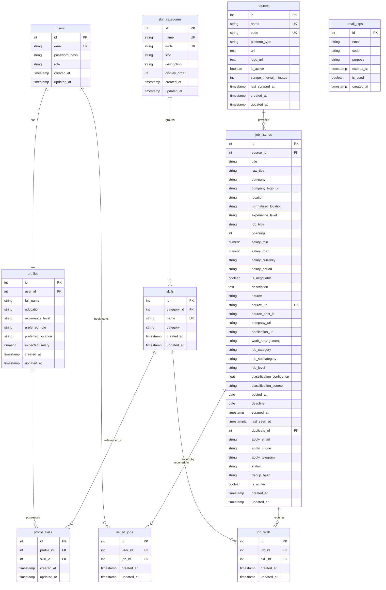
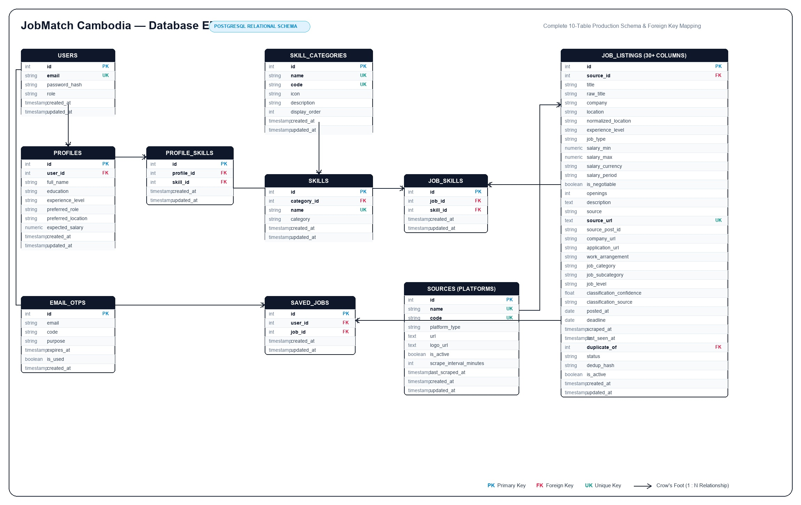

# Phase 3.3 — Database ERD

**Objective:** Design the data model your features need: every table, column, constraint and relationship, decided before any migration is written.

**Status:** Submitted · **Last updated:** 2026-10-18

## Done When

- [x] The ERD covers every Must-Have feature and journey, and renders on GitHub
- [x] Every table has a primary key and created/updated timestamps
- [x] Every foreign key has an on-delete rule in the data dictionary
- [x] No money columns use a floating-point type

## 1. Conventions

- Table names are plural and in snake_case (e.g. `job_listings`, `profile_skills`).
- Every table has a primary key `id`, plus `created_at` and `updated_at`.
- Money values (`salary_min`, `salary_max`, `expected_salary`) are stored as `numeric(10,2)` or integer cents, never as a floating-point type.
- Foreign keys are named `<entity>_id` and indexed.
- Junction tables handle many-to-many relationships (`profile_skills`, `job_skills`).

## 2. Entity Relationship Diagram

## 3. Data Dictionary

### Table: `users`
Stores user credentials and security roles.

| Column | Data type | Constraints | Nullable | Description |
|---|---|---|---|---|
| id | integer | PRIMARY KEY, SERIAL | No | Unique account identifier |
| email | varchar(255) | UNIQUE | No | User login email address |
| password_hash | varchar(255) | | No | Bcrypt hashed password |
| role | varchar(20) | DEFAULT 'user', CHECK (role IN ('user', 'admin')) | No | Authorization role |
| created_at | timestamp | DEFAULT now() | No | When the user registered |
| updated_at | timestamp | DEFAULT now() | No | When the user account was last modified |

---

### Table: `profiles`
Stores personal and professional information for candidate matching. Connected 1:1 with `users`.

| Column | Data type | Constraints | Nullable | Description |
|---|---|---|---|---|
| id | integer | PRIMARY KEY, SERIAL | No | Unique profile identifier |
| user_id | integer | UNIQUE, FK → users.id ON DELETE CASCADE | No | Associated user account |
| full_name | varchar(150) | | No | Candidate display name |
| education | varchar(150) | | Yes | University degree or major (e.g. Computer Science) |
| experience_level | varchar(50) | CHECK (experience_level IN ('entry', 'junior', 'mid', 'senior')) | No | Career seniority level |
| preferred_role | varchar(100) | | No | Target job title (e.g. Mobile Developer) |
| preferred_location | varchar(100) | | No | Preferred work city (e.g. Phnom Penh) |
| expected_salary | numeric(10,2) | CHECK (expected_salary >= 0) | Yes | Monthly expected salary in USD |
| created_at | timestamp | DEFAULT now() | No | When the profile was created |
| updated_at | timestamp | DEFAULT now() | No | When the profile was last updated |

---

### Table: `skill_categories`
Master taxonomy table grouping technical and professional competencies into structured domain clusters (3NF Database Normalization).

**Purpose & Function:**
1. **Mobile UI Categorization (SCR-07 Profile Skill Chips):** Prevents showing candidates a flat, unorganized list of 50+ skills. In Flutter, skills are rendered grouped under visual category headers/chips (e.g. Mobile, Backend, Database).
2. **Standardized Domain Taxonomy:** Normalizes skill domain classifications across mobile client and matching engine.
3. **Domain Coverage Scoring:** Allows calculating candidate readiness by technical domain.

| Column | Data type | Constraints | Nullable | Description |
|---|---|---|---|---|
| id | integer | PRIMARY KEY, SERIAL | No | Unique category identifier |
| name | varchar(100) | UNIQUE, INDEX | No | Human-readable category title ('Mobile', 'Backend', 'Database') |
| code | varchar(50) | UNIQUE, INDEX | No | Slug identifier ('mobile', 'backend', 'database') |
| icon | varchar(50) | | Yes | Material/Cupertino icon identifier for Flutter UI rendering |
| description | text | | Yes | Scope of competencies and tools included in this domain |
| display_order | integer | DEFAULT 0 | No | Visual display order on mobile profile chip selection screen |
| created_at | timestamp | DEFAULT now() | No | Creation timestamp |
| updated_at | timestamp | DEFAULT now() | No | Last update timestamp |

#### Predefined Skill Categories Breakdown:
| Category Name | Code | Icon | Description | Example Skills Included |
|---|---|---|---|---|
| **Mobile Development** | `mobile` | `phone_android` | Native and cross-platform smartphone application engineering | Flutter, Dart, React Native, Swift, Kotlin, Android, iOS |
| **Backend Development** | `backend` | `dns` | Server-side architectures, API design, business logic, microservices | Python, FastAPI, Java, Node.js, REST API, Laravel, Go |
| **Frontend Development** | `frontend` | `web` | Client-side web application user interfaces and responsive web tech | JavaScript, TypeScript, React, Vue.js, HTML/CSS, Tailwind |
| **Database & Storage** | `database` | `storage` | Relational, document, and in-memory data persistence systems | PostgreSQL, MySQL, MongoDB, Redis, SQLite |
| **DevOps & Cloud** | `devops` | `cloud` | Infrastructure, containerization, version control, CI/CD pipelines | Git, Docker, Kubernetes, AWS, Linux, CI/CD |
| **UI/UX & Design** | `design` | `palette` | User interface design, wireframing, prototyping, user experience | UI/UX, Figma, Adobe XD, Wireframing |
| **Data & AI** | `data` | `insights` | Data extraction, machine learning, data processing, statistics | Data Scraping, BeautifulSoup, Pandas, Scikit-learn, SQL |

#### Concrete Seed Data Example (`skill_categories` Table):
Demonstrates how the `code` column functions as a unique machine-readable slug and programmatic key for API parameters and Flutter client logic:

| `id` (PK) | `name` (UK) | `code` (UK) | `icon` | `description` | `display_order` | Example Skills Contained (`skills`) |
|:---:|---|---|---|---|:---:|---|
| **1** | **Mobile Development** | `mobile` | `phone_android` | Mobile smartphone application engineering (iOS & Android) | 1 | Flutter, Dart, React Native, Swift, Kotlin |
| **2** | **Backend Development** | `backend` | `dns` | Server-side architectures, REST APIs, business logic | 2 | Python, FastAPI, Node.js, Java, Go |
| **3** | **Frontend Development** | `frontend` | `web` | Client-side web application user interfaces | 3 | JavaScript, TypeScript, React, HTML/CSS |
| **4** | **Database & Storage** | `database` | `storage` | Relational, document, and in-memory databases | 4 | PostgreSQL, MySQL, MongoDB, Redis |
| **5** | **DevOps & Cloud** | `devops` | `cloud` | Infrastructure, containerization, CI/CD pipelines | 5 | Docker, Git, Kubernetes, AWS, Linux |
| **6** | **UI/UX & Design** | `design` | `palette` | User interface design, wireframing, prototyping | 6 | UI/UX, Figma, Adobe XD, Wireframing |
| **7** | **Data & AI** | `data` | `insights` | Data extraction, machine learning, analytics | 7 | Web Scraping, Pandas, Scikit-learn, SQL |

#### Relational Mapping Example (`skills` foreign key to `skill_categories`):
| `skills.id` | `skills.name` | `skills.category_id` (FK) | Resolves to `code` | Resolves to `name` |
|:---:|---|:---:|:---:|---|
| **101** | Flutter | **1** | `mobile` | Mobile Development |
| **102** | FastAPI | **2** | `backend` | Backend Development |
| **103** | PostgreSQL | **4** | `database` | Database & Storage |
| **104** | Docker | **5** | `devops` | DevOps & Cloud |
| **105** | Figma | **6** | `design` | UI/UX & Design |
| **106** | Pandas | **7** | `data` | Data & AI |

---

### Table: `skills`
Master catalog of standardized technical and soft skill tokens.

| Column | Data type | Constraints | Nullable | Description |
|---|---|---|---|---|
| id | integer | PRIMARY KEY, SERIAL | No | Unique skill identifier |
| category_id | integer | FK → skill_categories.id ON DELETE SET NULL, INDEX | Yes | Foreign key reference to master category entity |
| name | varchar(50) | UNIQUE, INDEX | No | Normalized skill tag (e.g. Flutter, Dart, Firebase, Git) |
| category | varchar(50) | | No | Denormalized category string label for backward compatibility |
| created_at | timestamp | DEFAULT now() | No | When the skill was added |
| updated_at | timestamp | DEFAULT now() | No | When the skill was last updated |

---

### Table: `profile_skills`
Junction table linking candidate profiles with their selected skills.

| Column | Data type | Constraints | Nullable | Description |
|---|---|---|---|---|
| id | integer | PRIMARY KEY, SERIAL | No | Unique junction identifier |
| profile_id | integer | FK → profiles.id ON DELETE CASCADE | No | Candidate profile reference |
| skill_id | integer | FK → skills.id ON DELETE CASCADE | No | Standardized skill reference |
| created_at | timestamp | DEFAULT now() | No | When the skill was associated with the profile |
| updated_at | timestamp | DEFAULT now() | No | When the record was updated |

---

### Table: `sources`
Master registry of recruitment sources and job aggregation channels (Web portals & Telegram channels).

| Column | Data type | Constraints | Nullable | Description |
|---|---|---|---|---|
| id | integer | PRIMARY KEY, SERIAL | No | Unique source identifier |
| name | varchar(100) | UNIQUE, INDEX | No | Human-readable platform name (e.g., 'Internships Cambodia', 'BongThom') |
| code | varchar(50) | UNIQUE, INDEX | No | Machine-readable identifier/slug (e.g., 'internships_cambodia', 'bongthom') |
| platform_type | varchar(50) | | No | Type of platform ('telegram', 'web_portal', 'api') |
| url | text | | No | Official channel link or website root URL |
| logo_url | text | | Yes | CDN/static URL for platform branding badge |
| is_active | boolean | DEFAULT true | No | Whether scheduled scraper should pull from this source |
| scrape_interval_minutes | integer | DEFAULT 60 | No | Frequency of scheduled scraping runs |
| last_scraped_at | timestamptz | | Yes | Timestamp of most recent scraping pass |
| created_at | timestamp | DEFAULT now() | No | Creation timestamp |
| updated_at | timestamp | DEFAULT now() | No | Last update timestamp |

---

### Table: `job_listings`
Stores clean, normalized job vacancies aggregated from external sources.

| Column | Data type | Constraints | Nullable | Description |
|---|---|---|---|---|
| id | integer | PRIMARY KEY, SERIAL | No | Unique job listing identifier |
| source_id | integer | FK → sources.id ON DELETE SET NULL, INDEX | Yes | Foreign key reference to master recruitment source |
| title | varchar(200) | | No | Normalized job title |
| raw_title | varchar(255) | | Yes | Original uncleaned title string as published on source |
| company | varchar(150) | | No | Verified hiring organization name |
| company_logo_url | text | | Yes | URL path to company branding logo image |
| location | varchar(100) | | No | Job location (e.g. Phnom Penh, Remote) |
| normalized_location | varchar(255) | | Yes | Standardized location identifier for geographic filtering |
| experience_level | varchar(50) | DEFAULT 'entry' | No | Required seniority level |
| job_type | varchar(50) | DEFAULT 'full-time' | No | Employment type (full-time, part-time, internship) |
| openings | integer | DEFAULT 1 | Yes | Total number of available openings for the position |
| salary_min | numeric(10,2) | CHECK (salary_min >= 0) | Yes | Minimum salary in USD (no float) |
| salary_max | numeric(10,2) | CHECK (salary_max >= salary_min) | Yes | Maximum salary in USD (no float) |
| salary_currency | varchar(10) | DEFAULT 'USD' | No | Currency denomination |
| salary_period | varchar(20) | DEFAULT 'monthly' | Yes | Pay frequency (monthly, yearly, hourly, daily) |
| is_negotiable | boolean | DEFAULT false | No | Whether salary is marked negotiable |
| description | text | | No | Full job description and requirements text |
| source | varchar(50) | | No | Origin platform ('Telegram', 'CamHR', 'BongThom') |
| source_url | text | UNIQUE | No | Direct URL to original post for external application |
| source_post_id | varchar(100) | INDEX | Yes | External unique identifier on original source platform |
| company_url | text | | Yes | Official hiring company website URL |
| application_url | text | | Yes | Direct application URL (Google Form, external portal) |
| work_arrangement | varchar(50) | | Yes | Work environment ('on-site', 'hybrid', 'remote') |
| job_category | varchar(100) | DEFAULT 'Unknown', INDEX | No | Primary domain/industry classification |
| job_subcategory | varchar(100) | DEFAULT 'Unknown' | No | Detailed technical or functional subcategory |
| job_level | varchar(50) | DEFAULT 'Unknown', INDEX | No | Standardized seniority classification |
| classification_confidence | float | | Yes | Confidence score from classifier (0.0 to 1.0) |
| classification_source | varchar(20) | DEFAULT 'rule' | No | Origin of classification ('jev' or 'rule') |
| posted_at | date | | Yes | Original publication date on source platform |
| deadline | date | | Yes | Application deadline |
| scraped_at | timestamptz | | Yes | Timestamp when listing was scraped or updated |
| last_seen_at | timestamptz | | Yes | Most recent scrape confirmation timestamp |
| duplicate_of | integer | FK → job_listings.id, INDEX | Yes | ID of canonical primary job if this is a cross-source duplicate |
| apply_email | varchar(255) | | Yes | Contact email address extracted from original posting |
| apply_phone | varchar(100) | | Yes | Contact phone number extracted from original posting |
| apply_telegram | varchar(100) | | Yes | Telegram contact handle/username extracted from post |
| status | varchar(20) | DEFAULT 'active' | No | Lifecycle status ('active', 'expired', 'closed') |
| dedup_hash | varchar(64) | INDEX | Yes | MD5 fingerprint for duplicate prevention |
| is_active | boolean | DEFAULT true | No | Whether the vacancy is currently active |
| created_at | timestamp | DEFAULT now() | No | When the listing was ingested into database |
| updated_at | timestamp | DEFAULT now() | No | When the listing was last updated |

---

### Table: `job_skills`
Junction table linking job listings with their required skills (extracted via NLP/parsing).

| Column | Data type | Constraints | Nullable | Description |
|---|---|---|---|---|
| id | integer | PRIMARY KEY, SERIAL | No | Unique junction identifier |
| job_id | integer | FK → job_listings.id ON DELETE CASCADE | No | Job listing reference |
| skill_id | integer | FK → skills.id ON DELETE CASCADE | No | Required skill reference |
| created_at | timestamp | DEFAULT now() | No | When the skill was tagged to the job |
| updated_at | timestamp | DEFAULT now() | No | When the record was updated |

---

### Table: `saved_jobs`
Stores user bookmarks for listings saved to be reviewed or applied to later.

| Column | Data type | Constraints | Nullable | Description |
|---|---|---|---|---|
| id | integer | PRIMARY KEY, SERIAL | No | Unique bookmark identifier |
| user_id | integer | FK → users.id ON DELETE CASCADE | No | User who bookmarked the vacancy |
| job_id | integer | FK → job_listings.id ON DELETE CASCADE | No | Bookmarked vacancy reference |
| created_at | timestamp | DEFAULT now() | No | When the bookmark was saved |
| updated_at | timestamp | DEFAULT now() | No | When the bookmark record was updated |

---

### Table: `email_otps`
Stores temporary 6-digit OTP verification codes for email verification and passwordless authentication.

| Column | Data type | Constraints | Nullable | Description |
|---|---|---|---|---|
| id | integer | PRIMARY KEY, SERIAL | No | Unique OTP identifier |
| email | varchar(255) | INDEX | No | Target recipient email address |
| code | varchar(6) | | No | 6-digit cryptographic verification code |
| purpose | varchar(50) | DEFAULT 'login_or_verify' | No | Purpose of OTP ('register', 'login', 'reset') |
| expires_at | timestamptz | | No | Expiration timestamp (default 10 minutes) |
| is_used | boolean | DEFAULT false | No | Whether this code was already consumed |
| created_at | timestamptz | DEFAULT now() | No | When the code was generated |
